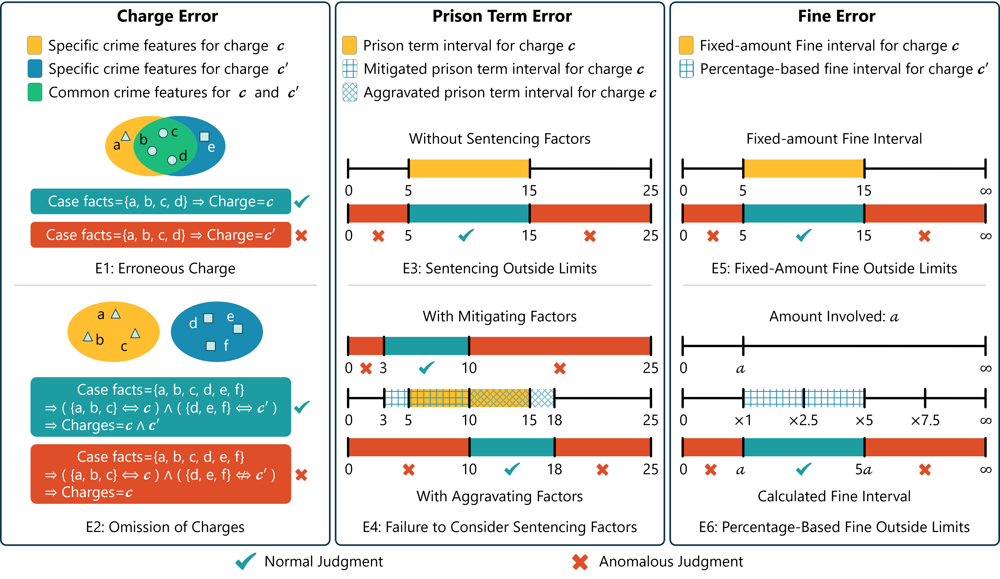

# AR-Bench

**Benchmarking Legal Reasoning with Judgment Error Detection, Classification and Correction for Chinese Criminal Cases**

[](https://huggingface.co/datasets/Yifei6672/AR-Bench)
[](LICENSE)

AR-Bench is a controlled benchmark for evaluating the legal diagnostic reasoning underlying appellate review. Given the facts, reasoning, and outcome of a finalized Chinese criminal judgment, a model must determine whether the judgment contains a legal application error, identify the error category, and provide corrections for the erroneous elements.

## Overview

Most legal AI benchmarks ask models to predict an outcome or generate a document before a judgment is finalized. AR-Bench instead treats judgment review as a diagnostic task. It focuses on three objectively verifiable elements in Chinese criminal cases: **charges**, **prison terms**, and **fines**.

AR-Bench contains **8,700 single-defendant judgments**, each represented with fine-grained annotations. Counterfactual errors are introduced at the semantic level while preserving local textual coherence, requiring models to identify conflicts between case facts, legal reasoning, cited legal articles, and final outcomes rather than relying on superficial lexical cues.

### Tasks

The three tasks are evaluated independently so that errors in an upstream task do not confound downstream results.

| Task | Input | Goal | Output |
| --- | --- | --- | --- |
| **Error Detection** | Finalized judgment document | Determine whether a legal application error is present | Binary decision |
| **Error Classification** | A judgment known to contain an error | Identify the primary affected element | `Charge`, `Prison Term`, or `Fine` |
| **Error Correction** | An erroneous judgment and its error category | Replace the erroneous element with a legally valid target | Exact charge or penalty value |

## Dataset

The benchmark includes both normal judgments and judgments with manually constructed anomalies. The dataset composition is designed for diagnostic assessment and should not be interpreted as reflecting the real-world prevalence of judicial errors.

| Category | Total | Normal | Anomalous |
| --- | ---: | ---: | ---: |
| Charges | 3,844 | 734 | 3,110 |
| Prison terms | 2,777 | 458 | 2,319 |
| Fines | 2,079 | 350 | 1,729 |
| **Total** | **8,700** | **1,542** | **7,158** |

Each sample contains **20 fine-grained attributes**. The four core textual components have the following mean character lengths:

| Component | Mean length |
| --- | ---: |
| Case facts | 380.9 |
| Reasoning process | 286.5 |
| Judgment | 87.6 |
| Relevant law articles | 557.9 |

### Error Taxonomy



AR-Bench defines three error categories with six fine-grained error types:

| ID | Category | Error type | Description |
| --- | --- | --- | --- |
| **E1** | Charge | Erroneous Charge | The facts support a different charge from the one imposed. |
| **E2** | Charge | Omission of Charges | The facts support multiple offenses, but one or more charges are omitted. |
| **E3** | Prison Term | Sentencing Outside Limits | The prison term falls outside the statutory interval for the charge. |
| **E4** | Prison Term | Failure to Consider Sentencing Factors | The sentence does not reflect applicable mitigating or aggravating factors. |
| **E5** | Fine | Fixed-Amount Fine Outside Limits | A fixed-amount fine falls outside its statutory range. |
| **E6** | Fine | Percentage-Based Fine Outside Limits | A proportional fine is inconsistent with the amount involved or the statutory multiplier range. |


## Load the Dataset

Dataset files are available from the [AR-Bench page on Hugging Face](https://huggingface.co/datasets/Yifei6672/AR-Bench).

## License

AR-Bench is released under the [MIT License](LICENSE), consistent with the license of the source [JuDGE dataset](https://github.com/oneal2000/JuDGE). Please retain the original copyright and attribution notices when redistributing derived materials.

## Citation

If you use AR-Bench in your research, please cite:

```bibtex
@misc{li2026arbench,
  title  = {{AR-Bench}: Benchmarking Legal Reasoning with Judgment Error Detection, Classification and Correction for Chinese Criminal Cases},
  author = {Li, Yifei and Zhang, Richong and Tu, Wanyu and Nie, Zhijie and Luo, Haokun and Yin, Chuantao},
  year   = {2026}
}
```